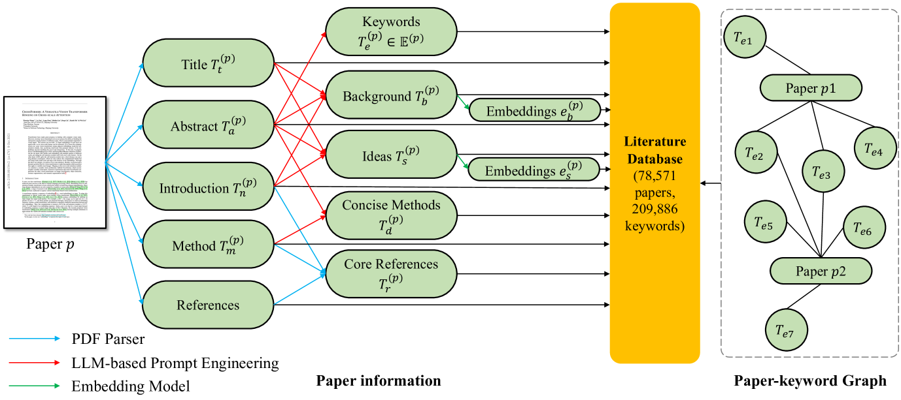

# IdeaGraph 相关工作、方法定位与实验方案

更新时间：2026-05-28

本文整理 scientific idea generation、科研知识图谱、GraphRAG 与自动评测相关工作，并据此明确 IdeaGraph 的方法边界、改进方向和实验方案。核心结论为：**“知识图谱 + LLM Agent 生成科研 idea”已经不是空白方向；IdeaGraph 更适合定位为可追踪、趋势感知、面向跨领域发现的科研图谱探索框架，并通过标准数据集和自动指标验证图谱机制是否有效。**

本文所讨论的 IdeaGraph 对应当前项目实现：从 OpenAlex 或本地论文构建 `Paper` 引用图，可选抽取 `Entity` 与 `Entity-Entity` 关系；`chat-idea` 在检索或指定核心论文后，通过 OpenAI-compatible tool calls 查询图谱上下文，生成 `Problem -> Method -> Experiment` 结构化 idea，并保留 `tool_trace`、`graph_context` 和 `idea_lineage`。

## 1. 研究现状：已有工作

本章按时间线介绍代表性工作，说明该方向从 literature-grounded ideation、idea agent、检索规划、文献链路组织、趋势预测到 KG-guided cross-domain design 的技术演进。排序口径为：正式发表论文按会议时间排序；未正式接收或仍为预印本的工作，按公开版本时间放入对应位置。主线为：SciMON -> ResearchAgent -> SciPIP -> NOVA -> MIR -> Chain of Ideas -> Impact4Cast -> GraphAgents。

### 1.1 SciMON

SciMON 收录于 ACL 2024 Long Papers。它的任务是 topic-conditioned scientific inspiration generation：给定论文中的 problem / motivation 背景和一个 seed term，系统生成一个可能的新 scientific hypothesis / idea。

**数据与任务构造**：SciMON 的数据来自论文语料中的 scientific information extraction。NLP 主实验从约 59k papers、374k sentences 中检索 inspiration，并构造 train / valid / test 形式的 forward / backward `used-for` 样本；论文还做了 biomedical case study。每个样本可理解为：

```text
background problem / motivation
+ seed term
-> target scientific idea / target relation completion
```

**方法实现**：其核心流程分为三部分：

```text
Background + seed term
-> inspiration retrieval
-> idea generation
-> iterative novelty boosting
```

第一步是 **inspiration retrieval**。SciMON 从三类来源检索 inspiration：

1. **Semantic neighbors**：把当前 background 和 seed term 编码后，在训练集中找语义相近的问题，再取相邻样本中的 target term 作为 inspiration。
2. **KG neighbors**：基于 background KG，取 seed term 在 task / method / material / metric 图中的相邻节点作为 inspiration。这里的 KG 边主要是 `used-for` 关系，例如某个 method 被用于某个 task。
3. **Citation neighbors**：如果能定位到背景文本来自哪篇论文，则在该论文引用的文献中找相似论文标题，作为 citation-based inspiration。

第二步是 **generation module**。SciMON 比较了 GPT-3.5 / GPT-4 的 zero-shot、few-shot、retrieval few-shot prompting，也训练了 T5 类模型。训练式方法中，它加入 in-context contrastive objective，目标是减少模型直接复制 background 中已有短语的问题。

第三步是 **iterative novelty boosting**。系统先生成初始 idea，再用生成 idea 去训练集 reference corpus 中检索最相近的已有 idea；如果相似度高于阈值，就把这些相似 idea 作为 negative examples 提示模型重新生成，直到与已有 idea 的相似度降到阈值以下。

**建图方式**：SciMON 建的是 background KG，不是完整论文知识图谱。构图先用 PL-Marker 抽取 Task、Method、Material、Metric 等实体和 `used-for` 关系，再用 SciCo 做共指、用 ScispaCy 做缩写归一，最后只保留高置信度结果。主实验中的 background KG 超过 197k nodes / 261k relations；citation neighbors 另来自论文引用关系。它的图用于 inspiration retrieval，而不是让 agent 在生成时动态调用图工具。

**效果评估**：SciMON 同时使用人工评估和自动指标。人工评估关注 relevance、novelty、clarity 和 reasonableness；自动指标包括 ROUGE、BERTScore、BARTScore 等。论文也指出，开放式 idea 生成中自动指标容易偏向表面相似度，不能完整反映高质量科研 idea。

### 1.2 ResearchAgent

ResearchAgent 最早以 arXiv 预印本形式公开于 2024 年 4 月，后收录于 NAACL 2025 Long Papers。它引用并对比了 SciMON 等前人工作。它以目标论文为中心，从 academic graph 中检索相关论文，并结合 paper-mined knowledge store 中的实体信息，分三步生成 research idea：

```text
Target paper
-> Related papers
-> Co-occurrence entities
-> Problem Identifier
-> Method Developer
-> Experiment Designer
-> LLM reviewer refinement
```

ResearchAgent 的实体知识主要来自 extracted entities 与 occurrence / co-occurrence statistics。实体之间的关系更接近“共同出现”，不是显式的 typed semantic relation。它的生成上下文主要在生成前整理，再交给 Problem Identifier、Method Developer、Experiment Designer 和 LLM reviewer refinement 完成分步生成与改写。

### 1.3 SciPIP

SciPIP 于 2024 年 10 月公开 arXiv 版本，曾投稿 ICLR 2025，OpenReview 状态为 withdrawn submission。它引用了 SciMON 和 ResearchAgent。withdrawn 表示该投稿未作为 ICLR 正式接收论文发表，不能等同于会议录用版本。SciPIP 的贡献主张是：构建科研文献库，通过多粒度检索找到相关论文，再用双路径策略生成 idea。



图 1 来自 SciPIP 原论文，展示其文献库构建流程：先用 PDF parser 抽取论文原始章节，再用 LLM prompt 将论文总结成结构化字段，随后编码入库，并额外保存 paper-keyword graph。

#### 文献库构建

SciPIP 使用过去十年 9 个 AI 领域会议的论文构建文献库，论文实验部分给出的规模是 78,571 篇，会议包括 ICML、NeurIPS、ICLR、ACL、EMNLP、NAACL、CVPR、ICCV 和 ECCV。该文献库不是直接从论文中抽取完整知识图谱，而是先解析论文，再用大模型把论文改写成若干适合检索和生成的字段。

它的构建过程分为三层：

```text
PDF parser
-> title / abstract / introduction / method / references
-> LLM prompt summarization
-> keywords / backgrounds / ideas / concise methods / core references
-> embedding index + paper-keyword graph
```

第一层是 **PDF parser**。它负责从 PDF 中抽取论文的原始章节和参考文献：

- title、abstract、introduction、method、references；

这一步不是大模型抽取，也不是关系抽取，只是把 PDF 变成可供后续处理的论文文本字段。

第二层是 **LLM prompt summarization**。SciPIP 用 prompt template 让 LLM 读取论文的 title、abstract、introduction、method 等内容，并输出结构化字段。论文把这些字段概括为 structured quintuple：

```text
keywords
backgrounds
ideas
concise methods
references
```

论文实验部分说明，backgrounds、ideas 和其他相关信息主要由 GPT-4o 总结；随后使用 jina-embedding-v3 对总结后的内容编码，用于后续检索。

需注意：SciPIP 的 “entities” 实际上更接近 keywords / keyphrases。它用 LLM prompt 从论文内容、用户输入和 brainstorming 结果中抽关键词短语，并把 paper-keyword 共现关系存入图中，用于检索扩展；它没有抽取带实体类型和关系类型的 semantic triples。

#### SKC 多粒度检索

SciPIP 论文里把用户输入称为 `user's query`，符号写作 `T_b^(u)`。但这里的 query 不是搜索引擎式关键词，而是 **research background / research problem description**：通常是一段描述研究领域背景、挑战和待解决问题的文本。论文也明确说该 query 一般包含某个研究领域的 background。后续 idea generation 里，SciPIP 还会先用 prompt 把较短的 query 改写成更详细的 transformed background，再用于 brainstorming 和 retrieval-based generation。

SciPIP 的检索流程称为 SKC-based retrieval，即综合使用 semantics、keyword 和 co-occurrence。更准确地说，它不是简单按 `semantic -> keyword -> co-citation` 串行检索，而是先构造三个候选论文集合，再合并和聚类：

```text
Input: research background / query T_b^(u)

N1 = semantic retrieval by background embedding
E(u) = query keywords + keywords from N1 + keyword-neighborhood expansion
N2 = papers containing expanded keywords E(u)
N3 = papers co-cited with papers in N1 union N2

N = N1 union N2 union N3
-> idea-similarity clustering
-> representative papers
```

其核心步骤包括：

1. **Semantics-based retrieval**：把用户 research background 编码成向量，与文献库中论文的 background embedding 做相似度检索，得到第一批候选论文 `N1`。
2. **Query keyword extraction**：用 LLM prompt 从用户 research background 中抽取 keywords。这里的 keywords 不是人工输入的检索词，而是模型从 background 文本中抽出的名词短语。
3. **Keywords from semantic results**：对 `N1` 中论文，不再重新抽取，而是直接读取文献库中预先存好的 paper keywords。
4. **Keyword-neighborhood expansion**：在 paper-keyword graph 上扩展关键词集合：如果当前 keyword 出现在某些论文中，就把这些论文的其他 keywords 作为候选补充；随后用过滤规则去掉噪声关键词，得到最终扩展关键词集合 `E(u)`。
5. **Keyword-based retrieval**：用 `E(u)` 检索包含这些 keywords 的论文，得到第二批候选论文 `N2`。
6. **Co-occurrence-based retrieval**：对 `N1 union N2` 中的论文，找与其经常被共同引用的论文，得到第三批候选论文 `N3`。这里的 co-occurrence 主要指 paper-level co-citation，不是实体语义关系。
7. **Literature clustering and filtering**：合并 `N1`、`N2`、`N3` 后，用 idea / summary embedding 做聚类，再从每个 cluster 中选择代表论文，以降低候选冗余。

#### Dual-path idea generation

SciPIP 的生成策略包含三个变体：

| 变体 | 流程 | 作用 |
|---|---|---|
| SciPIP-A | SKC 检索 -> core problem -> 约 10 个 initial ideas -> filter -> 3 到 4 个 refined ideas | 只使用文献路径，强调可行性 |
| SciPIP-B | 文献路径 + background-only brainstorming -> 合并过滤 -> refinement | 一路保留文献支撑，一路保留发散性 |
| SciPIP-C | brainstorming 先产生关键词，再将关键词反哺 SKC 检索，最后合并两路 idea | brainstorming 同时影响检索和生成 |

#### OpenReview 审稿信息

SciPIP 的 OpenReview 页面公开了 4 条 official reviews。当前文档记录的平均 rating 约 3.5，contribution 均值约 1.75。审稿意见可以概括为：

**审稿人认可的方面：**

- 任务具有实际意义，scientific idea generation 是重要问题；
- 系统流程较完整，覆盖文献库构建、检索、生成、过滤和 refinement；
- 将 semantic retrieval、keyword retrieval 和 citation co-occurrence 结合，具有工程实用价值；
- 生成结果和案例分析提供了一定的可用性证据。

**审稿人指出的主要问题：**

- 原创性不足：semantic retrieval、keyword matching、co-citation、clustering、LLM prompting 更像已有技术组合；
- 消融不足：没有充分证明 SKC、dual-path、filter、refinement 各自贡献；
- 过度依赖 LLM judge：novelty、feasibility、similarity 等判断的可靠性受质疑；
- 数据污染风险：实验论文可能已经以 arXiv / ARR 等形式进入模型训练数据；
- baseline 不够强：需要更强 embedding、ranking、LLM reranking 和标准 IR 指标；
- 领域范围偏窄：主要在 AI / ML / NLP 范围内实验，但表述容易被理解为通用 scientific idea proposer。

### 1.4 NOVA

NOVA 收录于 Findings of ACL 2025。它引用 SciMON、ResearchAgent，也引用 Chain of Ideas 的预印本。它研究的问题是：LLM 在 research idea generation 中容易生成重复、局部、缺乏多样性的 idea，原因之一是知识获取没有明确方向。NOVA 的核心方法是 iterative planning：模型不是一次性检索相似论文，而是先规划需要探索哪些外部知识领域，再按计划检索、扩展上下文，并反复迭代 seed ideas。

**数据与任务构造**：NOVA 的输入通常是一篇 input paper，输出是面向该论文的 research proposal / idea。实验从 CVPR 2024、ACL 2024、ICLR 2024 的 7,805 篇论文出发，经 LLM-related keyword filtering 得到约 2,000 篇，再按引用阈值筛到 153 篇，最后加入 17 篇 HuggingFace Daily Papers 高评分论文，形成 170 篇 input papers。外部知识主要来自 academic search engine、HuggingFace Daily Papers、GitHub ML Papers of the Week、预印本和科学创新理论。

**方法实现**：总体流程是三阶段：

```text
Input paper
-> multi-source seed idea generation
-> planned RAG based seed idea iteration
-> proposal generation
```

第一阶段是 **multi-source seed idea generation**。NOVA 从三类信息生成初始 seed ideas：

1. **Scientific innovation theories**：把 Kuhn、Popper、Lakatos 等科学创新理论整理成提示，要求模型从“定义新问题”“发现现有方法缺陷”“探索边界条件”等角度提出 seed idea。
2. **Latest research trends**：监控 HuggingFace Daily Papers、GitHub ML Papers of the Week、预印本等来源，用 LLM 总结近期趋势，再把趋势融入 seed idea。
3. **Domain expertise / related works**：用 academic search engine 检索与 input paper 相关的论文，让模型分析 input paper 和 related works 的不足。

第二阶段是 **planned RAG**。NOVA 与普通 RAG 的区别在于，它先让 LLM 为当前 seed idea 制定 search plan。这个 plan 会明确需要探索的研究方向和知识领域，例如“实时数据处理”“论文追踪”“知识库更新”等。随后系统使用 FAISS academic search engine，根据 plan 中的关键词检索论文，再把检索到的新知识、原始 input paper 和当前 seed idea 一起输入模型，生成新的 seed ideas。论文实现中检索库覆盖 2022 到 2024 年 AI-related papers，embedding 使用 all-MiniLM-L6-v2，主模型使用 GPT-4o。实验设置 3 轮迭代，每个旧 seed idea 生成 3 倍数量的新 seed ideas；最后用 k-means 聚类成 100 组，并从每组选择一个 idea 形成最终 100 个候选。

第三阶段是 **proposal generation**。系统把最终 seed idea pool 扩展成 proposal：先生成初版 proposal，再把 method 部分拆成多个 sub-modules，要求模型分别细化这些模块，最后形成完整 proposal。

**建图方式**：NOVA 不构建显式知识图谱。它的核心结构是 iterative plan、检索结果集合、seed idea pool 和聚类后的代表 ideas；知识组织主要靠向量检索、LLM 规划和 prompt 上下文，而不是 `Entity-Relation` 图。

**效果评估**：NOVA 同时使用机器评估和人工评估。机器评估包括 Swiss System Tournament 式 pairwise ranking、novelty、diversity 等，基线包括 AI-Researcher、AI-Scientist 和 ResearchAgent；人工部分招募 10 名 LLM 相关方向专家，评价 novelty 和 overall quality，包括 feasibility 与 effectiveness。因此它已经覆盖“机器 judge + 专家评估”的常见路线。

### 1.5 MIR: Methodology Inspiration Retrieval

MIR: Methodology Inspiration Retrieval 收录于 ACL 2025 Long Papers。它引用 SciMON、ResearchAgent 和 Chain of Ideas 的预印本。它不直接做完整 idea generation，而是定义了一个更窄、更可评测的检索任务：给定 research problem 和 motivation，检索能够启发解决方案的方法论文。它的关键价值在于把“idea 的 Method 部分需要什么文献证据”单独抽成 retrieval benchmark。

**数据与任务构造**：MIR 的任务输入和输出是：

```text
Input: research proposal = {research problem, motivation}
Output: methodologically inspirational papers
```

它构造了 MIR-MultiCite 数据集，训练集为 2019 年以前的 proposals，开发集为 2019 年 1 月到 6 月的 proposals，测试集为 2019 年 6 月之后的 proposals；另外还有扩展到 2024 年中以前论文的 augmented training set。数据构造流程是：

1. 从 MultiCite 中获取 citing paper 的 title、abstract 和 citation contexts。
2. 用 LLM 从 citing paper abstract 中抽取 research problem 和 motivation，形成 proposal。
3. 通过 Google Search API / Semantic Scholar API 将 citation contexts 映射到被引论文。
4. 根据 MultiCite citation intent，把引用分为 methodology intent 和 non-methodology intent；methodology intent 主要对应 `uses`、`extends`。
5. 每个样本保存 proposal、cited papers、citation contexts 和 citation intents。

**建图方式**：MIR 提出的图结构叫 **Methodology Adjacency Graph (MAG)**。MAG 中，节点可以看作 proposal / paper，边是从 proposal 指向被引论文的 directed citation edge；边上带 citation context 和 intent。它强调的是 citation-based methodological lineage：某篇被引论文是否真的在方法上启发了当前 proposal，而不仅是语义相似或普通背景引用。

**方法实现**：MIR 的模型方法包括两层：

```text
MAG construction
-> MAG-guided retriever fine-tuning
-> optional LLM reranking
```

第一层是 **MAG-guided retriever fine-tuning**。论文用 MAG 构造 triplet training samples，让 proposal embedding 更接近 methodology-inspiration paper，而远离语义相似但方法上无关的 paper。它在 SPECTER2、Stella 等 retriever 上做 task-specific fine-tuning，并使用 citation context 作为额外信号，让模型学习“某篇方法论文如何启发当前问题”。

第二层是 **LLM reranking**。在 first-stage retriever 返回 top-k papers 后，LLM 进一步判断每篇论文是否 methodologically relevant。论文测试了 point-wise reranking 和 MIR-Agent。MIR-Agent 会先分析 proposal 的 sub-problems 和 generic action plan，再逐篇分析候选论文的适用性，最后给出 relevance judgment。

**效果评估**：MIR 主要使用机器评估，因为它是检索任务。评价指标是标准 IR 指标，包括 Recall@K 和 mAP。论文结果显示，MAG-guided fine-tuning 相比强 retriever baseline 有明显提升，LLM reranking 还能进一步提高 Recall@3 和 mAP。这个任务比开放式 idea generation 更容易做自动评测，因为 gold label 来自带 intent 的 citation graph；同时论文也对 LLM 抽取的 proposal 做人工质量检查。

### 1.6 Chain of Ideas

Chain of Ideas 于 2024 年 10 月公开预印本，后收录于 Findings of EMNLP 2025。它引用 SciMON 和 ResearchAgent；由于预印本较早公开，NOVA 和 MIR 的参考文献中也引用了它。它提出 CoI agent，把相关文献组织成一条 idea development chain，用来模拟一个研究方向如何从早期方法逐步发展到当前方法，再让 LLM 基于这条链预测未来趋势、生成候选 idea 和实验设计。

**数据与任务构造**：CoI 的输入是一个 research topic。论文使用 HuggingFace Daily Papers 中 2024 年 8 月 1 日到 9 月 15 日的论文构造候选 topic，这个时间段在模型训练 cutoff 之后；随后由 10 名 AI experts 选择和验证 topic，最终形成 50 个 research topics。相关文献主要通过 Semantic Scholar 检索得到。

**方法实现**：系统不是把检索到的文献直接堆进 prompt，而是先构造多条 Chain of Ideas：

```text
Research topic
-> multiple perspective queries
-> anchor papers
-> backward / forward chain construction
-> trend summarization
-> idea generation
-> experiment design
```

第一步是 **query and anchor retrieval**。给定 topic 后，LLM 先生成多个不同视角的 query；每个 query 通过 Semantic Scholar 检索得到一个 top-ranked anchor paper。每个 anchor paper 对应一条 CoI branch。

第二步是 **chain construction**。CoI 从 anchor paper 同时向前和向后扩展：

- **forward direction**：找直接引用 anchor paper 的后续论文，用 embedding 相似度按 topic + anchor abstract 排序，选择最相关的后续论文继续扩展，直到达到预设链长或没有有价值后续工作。
- **backward direction**：让 LLM 阅读 anchor paper，筛选其 references 中真正作为基础、baseline 或同主题工作的论文，再选择最相关的前置论文继续向前追溯；遇到高被引 milestone paper 或无相关引用时停止。

第三步是 **idea extraction and trend summarization**。系统从链上每篇论文中抽取 idea、experiment design 和 key entities，并保留链上相邻 idea 的演化关系。之后 LLM 总结链中已有工作的 current trends。

第四步是 **idea generation**。LLM 输入 CoI、current trends 和 key entities，先预测 future trend，再逐步写出 motivation、novelty 和 methodology。随后使用 novelty-check agent：检索与候选 idea 相似的论文，让另一个 LLM 判断候选 idea 是否与已有工作过近；如果不够新，就进入下一轮生成。多条 CoI branch 生成的 ideas 会做 pairwise comparison，选出胜率最高的 idea。

第五步是 **experiment design**。系统使用链上论文的实验设计作为 few-shot examples，让 LLM 为最终 idea 设计实验；review agent 检查实验是否清晰、是否包含 dataset / model / protocol 等关键要素，并据此补充检索和 refinement。

**建图方式**：CoI 不构建通用知识图谱，但构建局部 chain structure。chain 的节点是论文及其抽取出的 idea、experiment design、key entities；边来自引用方向和 LLM 判断出的研究发展关系。主实验中 CoI branch 数为 3，最大链长为 5；论文还分析了 50 条 CoI 中 213 篇链上论文，其中约 29.64% 被 GPT-4o 判断为跨领域论文。

**效果评估**：CoI 使用 Idea Arena 做 pairwise evaluation。机器评估由 LLM judge 比较不同方法生成的 idea，并计算 Elo；人工评估由 10 名 AI experts 按同样 pairwise 标准评价。评价维度包括 novelty、significance、clarity、feasibility、expected effectiveness；实验设计还评估 feasibility、technical quality 和 clarity。论文报告 human 与 GPT-4o judge 的平均一致率约 74.9%。

### 1.7 Impact4Cast

Forecasting high-impact research topics via machine learning on evolving knowledge graphs 收录于 Machine Learning: Science and Technology 2025，项目名为 Impact4Cast。它不直接生成完整 research idea，而是预测“尚未被共同研究的科学概念对”未来是否会成为高影响研究方向。该工作与本文主题相关之处在于：它把 evolving knowledge graph、时间切片、引用影响力和 future topic forecasting 结合起来，是 trend-aware graph ranking 的正式发表代表工作。

**数据与任务构造**：该工作先从 arXiv、bioRxiv、medRxiv 和 chemRxiv 的约 244 万篇预印本元数据中抽取科学概念。概念候选来自标题和摘要，使用 RAKE 自动抽取关键词，再通过出现频次阈值、NLP 清洗和人工检查过滤，得到超过 368,000 个 scientific concepts。主实验聚焦 optics 和 quantum physics 相关子领域，最终使用 37,960 个概念作为图谱节点。

论文随后使用 OpenAlex 构建 citation-augmented evolving knowledge graph。OpenAlex 原始库包含超过 9,200 万篇论文，其中约 2,116 万篇论文至少包含两个已识别概念，因此能形成概念共现边。最终图谱包含 37,960 个 vertices 和超过 2,600 万条 edges；如果按多篇论文形成的多重 concept pairs 计数，则包含约 1.9 亿 concept pairs。数据时间覆盖 1709 年到 2023 年 4 月，引用统计主要使用 2012 到 2023 年的年度 citation 信息。

**建图方式**：图中节点是 scientific concepts；如果两个概念同时出现在一篇论文的 title 或 abstract 中，就在二者之间形成边。边不是带语义类型的 relation，而是“两个概念被共同研究”的 co-occurrence / co-investigation 关系。每条边还带有时间和影响力信息：

```text
Concept_i --co-occurred_in_paper_with--> Concept_j
edge attributes = publication year + annual citations + total citations
```

如果多篇论文形成同一个概念对，边的年度引用数和总引用数会累加。因此该图不是普通静态共现图，而是 evolving、citation-augmented concept graph。

**方法实现**：任务被定义为 supervised binary classification：

```text
unconnected concept pair at time t
-> network features + citation impact features
-> ML classifier
-> whether the pair will exceed impact threshold IR in future years
```

训练时，模型选择某一年尚未连接的概念对，计算 141 个特征，再用未来 1 到 5 年的引用结果构造监督信号。特征包括：

- 41 个 network features：节点邻居数、PageRank、cosine / geometric / Simpson similarity 等；
- 100 个 impact features：节点总引用、年度引用、概念对引用比例等。

主模型是 fully connected feed-forward neural network。扩展 benchmark 中还比较了 Transformer、Random Forest 和 XGBoost。Impact range `IR` 是高影响阈值，例如 `IR = 100` 表示某概念对在未来指定时间窗口内获得至少 100 次引用，则被标记为 high-impact。

**效果评估**：评估采用历史回放。典型设置是：用 2016 年之前尚未连接的 concept pairs 及 2016 到 2019 年结果训练，再用 2019 年尚未连接的 concept pairs 预测 2019 到 2022 年结果。主指标是 ROC-AUC。论文报告多数实验 AUC 超过 0.9；在更难的“beyond link prediction”任务中，模型只在未来确实会连接的概念对中判断高影响和低影响，AUC 仍高于随机水平。Benchmark 数据还覆盖 2 到 4 年训练窗口、1 到 5 年预测窗口，以及不同 IR 阈值。

该工作的输出不是自然语言 idea，而是对 future concept pair 的 high-impact ranking。因此它更适合支撑趋势感知排序和历史回放验证，不适合作为最终 idea generation benchmark。

### 1.8 GraphAgents

GraphAgents: Knowledge Graph-Guided Agentic AI for Cross-Domain Materials Design 于 2026 年 2 月公开 arXiv 预印本。它不是通用 scientific idea generation benchmark 上的工作，而是面向材料设计场景，使用大规模知识图谱和多 agent 推理寻找 PFAS-free 替代材料，案例集中在 biomedical tubing。该工作与本文主题相关之处在于：它明确把 knowledge graph traversal、evidence retrieval、cross-domain connection 和 hypothesis generation 放在同一个 agentic pipeline 中。

**数据与任务构造**：任务输入是一个材料替代设计问题，例如“为 biomedical tubing 寻找可替代 PFAS 的可持续材料”。系统需要同时考虑 tensile strength、friction coefficient、thermal stability、chemical resistance、biocompatibility 等多目标约束，并输出候选材料设计假设。论文构建了两个知识图谱：

- **PFAS-Specific Knowledge Graph**：来自 Web of Science 中 “Per- and polyfluoroalkyl substances” 相关论文检索，4,824 条结果中成功获取 4,716 篇全文；
- **Material Properties Knowledge Graph**：由 polymer experts 给出的 PFAS property keywords 检索得到，最终用于实验的是 63,222 条 abstracts 的随机样本；
- 两个图谱规模分别为 PFAS-Specific 144,380 nodes / 458,643 edges，Material Properties 315,020 nodes / 773,541 edges。

**方法实现**：GraphAgents 是一个顺序式五 agent pipeline：

```text
User material-design query
-> Planner
-> Hybrid GraphWeave
-> Evaluator
-> Creative GraphWeave
-> Engineer
-> material hypothesis
```

第一步是 **Planner**。它把用户的材料设计问题拆成若干 subquestions，覆盖材料性质、操作条件、失效模式和接口要求。例如对 biomedical tubing，它会拆出 tensile strength、low friction、thermal stability、sterilization resistance、biocompatibility 等设计维度。

第二步是 **Hybrid GraphWeave**。它同时使用文本检索和图谱检索回答每个 subquestion：先把 query embedding 到向量空间，在 ChromaDB 中检索 top-k text chunks，论文设置 `k = 5`；再利用这些 text chunks 对应的 chunk ID 找到知识图谱中带相同来源标记的 edges 和 nodes，组装成局部 subgraph。这样每个回答同时包含原文证据和图结构证据。

第三步是 **Evaluator**。它读取 Hybrid GraphWeave 的结果，抽取设计相关 keywords 和指标范围，例如 tensile strength、thermal stability、friction coefficient 及其数值区间。这些 keywords 会作为后续跨领域图谱遍历的起点。

第四步是 **Creative GraphWeave**。它把 Evaluator 抽出的 keywords 映射到 Material Properties Knowledge Graph 中最相近的节点，然后在节点对之间运行 graph traversal / pathfinding。论文实现了 Shortest Simple Path、Top-N Shortest Simple Path、BFS with Semantic Stop 和 DFS 等策略。不同遍历策略会产生不同风格的候选材料假设：短路径更偏 exploitation，DFS / Top-N 等更容易带来 exploratory cross-domain connections。

第五步是 **Engineer**。它综合前面得到的文本证据、局部子图、跨领域路径和设计约束，生成最终材料设计假设。

**建图方式**：GraphAgents 的图谱由论文或摘要文本自动构建。流程是：

```text
PDF / abstract corpus
-> Markdown conversion
-> section-level chunking
-> LLM structured triplet extraction
-> within-paper graph composition
-> cross-paper node alignment and merge
-> large-scale KG
```

其中 LLM 抽取的结构是 graph fragment：节点包含 `id` 和 `type`，边包含 `source`、`target` 和 `relation`。这里的 `relation` 更接近由 LLM 生成的自然语言谓词或关系标签，不是预先定义好的有限关系类型集合。跨论文合并时，系统使用 nomic embedding 对节点做语义相似度匹配，相似度高于 0.95 的节点会被合并，并保留较高 degree 的节点。

**效果评估**：GraphAgents 主要做模块消融，不使用标准 idea benchmark，也没有实验室材料验证。论文比较五种系统配置：

| 配置 | 启用组件 |
|---|---|
| All Components Enabled | Planner + Hybrid GraphWeave + Evaluator + Creative GraphWeave + Engineer |
| Expanded Retrieval | Planner + Hybrid GraphWeave + Engineer |
| Direct Graph Exploration | Hybrid GraphWeave + Evaluator + Creative GraphWeave + Engineer |
| Direct Retrieval | Hybrid GraphWeave + Engineer |
| LLM Only | Engineer only |

评估使用 blind LLM-as-judge，对同一提示下不同配置的输出打分。评价维度包括 task decomposition、context enrichment、cross-subtask integration、deep reasoning、novelty 和 source attribution。论文报告完整五 agent pipeline 在多数维度上高于 ablated variants，尤其在 task decomposition、context enrichment 和 source attribution 上明显优于 LLM Only；但 Direct Graph Exploration 的 novelty 分数高于完整 pipeline，说明更开放的图遍历可能带来更强新颖性，同时也更少受证据约束。

### 1.9 代表性工作总览

下表按上文介绍顺序总结每篇代表性工作的核心实现、数据、图结构和评估方式。

| 顺序 | 工作 | 时间与状态 | 核心流程 | 数据来源 | 图或结构化知识 | 效果评估 |
|---|---|---|---|---|---|---|
| 1 | SciMON | ACL 2024 Long Papers | background + seed term -> inspiration retrieval -> idea generation -> novelty boosting | NLP 主实验约 59k papers / 374k sentences；另有 biomedical case study | background KG，节点为 scientific entities，边主要是 `used-for`；另用 citation neighbors | 人评 relevance、novelty、clarity、reasonableness；自动指标 ROUGE、BERTScore、BARTScore 等 |
| 2 | ResearchAgent | arXiv 2024-04；NAACL 2025 Long Papers | target paper -> related papers -> co-occurrence entities -> Problem / Method / Experiment -> reviewer refinement | 多学科核心论文、引用图和 paper-mined entity knowledge store | academic graph + entity occurrence / co-occurrence knowledge store | 人评 + model-based evaluation；比较 naive、无实体检索和 full ResearchAgent |
| 3 | SciPIP | arXiv 2024-10；ICLR 2025 withdrawn submission | literature database -> SKC retrieval -> dual-path idea generation -> filter / refinement | 过去十年 9 个 AI 领域会议论文，实验规模约 78,571 篇 | paper-keyword graph、keyword co-occurrence、paper citation co-occurrence；无 typed semantic triples | OpenReview 审稿指出原创性、消融和 LLM judge 可靠性不足；论文自身包含人评和 LLM 评估 |
| 4 | NOVA | Findings of ACL 2025 | seed idea generation -> planned RAG -> iterative seed expansion -> proposal generation | CVPR / ACL / ICLR 2024 论文筛选后 153 篇，加 17 篇 HuggingFace Daily Papers，共 170 seed papers | 不建显式 KG；使用 search plan、FAISS 向量检索、seed idea pool 和聚类 | Swiss System Tournament、novelty、diversity 等机器评估；另有 10 名专家人工评价 |
| 5 | MIR | ACL 2025 Long Papers | proposal extraction -> MAG construction -> retriever fine-tuning -> LLM reranking | MultiCite citation contexts 构造 MIR-MultiCite，另有 arXiv augmented training set | Methodology Adjacency Graph，边来自 citation context 和 methodology intent | 标准检索指标 Recall@K、mAP；附人工检查 proposal 抽取质量 |
| 6 | Chain of Ideas | arXiv 2024-10；Findings of EMNLP 2025 | topic -> anchor papers -> backward / forward chain -> trend -> idea -> experiment design | HuggingFace Daily Papers 构造 50 个 topics，Semantic Scholar 检索相关论文 | 局部 paper / idea chain，边表示引用方向和研究发展关系 | Idea Arena pairwise evaluation、Elo；GPT-4o judge + 10 名专家人评 |
| 7 | Impact4Cast | Machine Learning: Science and Technology 2025 | evolving concept graph -> network / citation features -> high-impact concept-pair prediction | 超过 2,100 万 OpenAlex papers 构图；主实验聚焦 optics / quantum physics 的 37,960 个 concepts | citation-augmented evolving concept graph；边为 title / abstract concept co-occurrence，不是 typed semantic relation | 历史回放；ROC-AUC；多数实验 AUC 超过 0.9；另有模型和时间窗口 benchmark |
| 8 | GraphAgents | arXiv 2026-02 | material-design query -> Planner -> Hybrid GraphWeave -> Evaluator -> Creative GraphWeave -> Engineer -> material hypothesis | PFAS 相关 4,716 篇全文；Material Properties KG 使用 63,222 条 abstracts 样本 | PFAS-Specific KG 和 Material Properties KG；LLM 抽取 entity-relation-entity triplets；relation 是文本标签而非固定本体类型；支持 chunk-level source trace | GPT-5 blind LLM-as-judge 消融；比较五种 agent / graph 组件配置；无材料实验验证 |

从时间线看，SciMON 和 ResearchAgent 是正式发表的前人基础；SciPIP 是方法相近但发表状态较弱的对照；NOVA、MIR 和 Chain of Ideas 是 2025 年在前人基础上的推进；Impact4Cast 说明 evolving KG 可用于高影响研究主题预测；GraphAgents 则说明 KG-guided agentic cross-domain design 在材料领域已经出现相近预印本工作。

## 2. IdeaGraph 方法定位与改进方向

### 2.1 技术贡献方向

#### 方向一：Typed scientific evidence graph

将论文、概念、问题、方法、场景、创新点组织成显式图谱：

```text
Paper -[:CITES]-> Paper
Paper -[:CONTAINS]-> Entity
Entity -[:REL]-> Entity
```

该方向要回答的问题是：相比纯文本向量检索，结构化关系是否能更好支持复杂科研检索、证据组织和 idea 生成。

#### 方向二：Runtime graph exploration and traceability

生成过程不只是在 prompt 中塞入预检索文本，而是让模型在运行时调用图谱工具查询邻居、路径和相关证据，并保存：

- `tool_trace`：模型实际调用了哪些工具；
- `graph_context`：最终使用了哪些图谱证据；
- `idea_lineage`：idea 的 Problem、Method、Experiment 分别能追溯到哪些论文、实体或路径。

该方向要回答的问题是：运行时图谱探索是否比固定检索上下文更有效，且最终 idea 是否真的受图谱证据支撑。

#### 方向三：Cross-domain path search

在图谱上寻找跨领域桥接路径：

```text
起点领域 A
-> 中间机制/方法 B
-> 目标领域或候选发现 C
```

该方向要回答的问题是：跨领域路径是否能发现文本相似度或普通共现难以召回的隐藏连接。

#### 方向四：Trend-aware graph ranking

在节点、边和路径排序中加入时间趋势信号，包括近期增长、新出现边、证据密度和历史未直接连接等因素。

该方向要回答的问题是：趋势信号是否能在 cutoff 时间之前更早发现未来有价值的节点、边和 inspiration concepts。

### 2.2 与已有工作的差异定位

| 已有工作或方向 | 已覆盖内容 | 已有表述边界 | IdeaGraph 差异定位 |
|---|---|---|---|
| ResearchAgent | 目标论文驱动、相关论文、实体共现、三段式生成、reviewer refinement | “提出 Problem/Method/Experiment agent” | typed semantic relation graph、运行时图谱工具调用、可追踪 evidence lineage |
| SciPIP | 文献库、SKC 检索、paper-keyword graph、citation co-occurrence、dual-path generation | “检索增强 idea generation” | 更细的 typed relation、模块级消融、标准 IR / hidden discovery 指标 |
| SciMON | semantic / KG / citation inspiration retrieval、background KG、novelty boosting | “用文献和图邻居提升 novelty” | 更完整的 typed evidence graph、运行时 tool exploration、最终 idea 结构化 lineage |
| NOVA / Chain of Ideas | 迭代检索规划、文献链路组织 | “LLM 规划检索再生成 idea” | 图谱路径和图结构本身的可验证贡献 |
| MIR | 方法灵感检索、Methodology Adjacency Graph、MAG-guided retriever fine-tuning | “检索能启发方法的论文” | 将方法证据纳入 typed graph lineage，并验证 Method 部分是否受益 |
| Impact4Cast | evolving concept graph、citation impact features、future high-impact concept-pair prediction | “预测未来高影响研究主题” | 将趋势信号作为图谱排序组件，并继续验证其是否能提升最终 idea 生成或跨领域发现 |
| GraphAgents | KG-guided multi-agent cross-domain materials design、GraphWeave 图遍历、组件消融 | “知识图谱指导跨领域材料设计” | 面向论文知识图谱和科研 idea generation benchmark，验证跨领域路径、趋势信号和最终 idea 对齐 |
| Many Heads / VIRSCI | 多 agent 生成、评价、细化 | “多 agent 科研 ideation” | 单独验证图谱证据，而非强调 agent 数量 |
| GraphRAG | 文本构图和图增强问答 | “GraphRAG 用于科研” | 面向 idea generation 的 typed evidence、cross-domain path 和 lineage |

## 3. 实验方案

### 3.1 AI Idea Bench 2025

AI Idea Bench 2025 是第一阶段主实验数据集，用于评估 IdeaGraph 能否在 AI 领域基于过去论文生成与未来真实论文对齐的 research idea。它的核心思想是把未来发表的 target paper 作为 proxy ground truth，让系统只基于 target paper 之前可见的 inspiration / motivating papers 生成 idea，再比较生成结果与 target paper 的 topic、motivation 和 experimental plan 是否一致。

**规模与状态**：数据集包含 3,495 篇 AI target papers 及其 motivating papers，公开了 project page、arXiv 论文和 GitHub 数据。当前项目本地已有 target JSON 和 pilot 数据，可作为第一阶段主实验起点。

**原始任务**：AI research idea generation。输入是 topic、inspiration papers 或 motivating papers，输出是候选 research idea。评价时将候选 idea 与未来 target paper 对齐。

**指标**：

- **I2I motivation rating**：生成 idea 与 target paper motivation 的对齐程度。
- **I2I experiment plan rating**：生成 idea 与 target paper experimental plan 的对齐程度。
- **I2T**：生成 idea 与 target paper topic 的对齐程度。
- **IMCQ**：生成 idea 是否帮助模型在多选题中识别正确 target idea。
- **IC**：多个方法生成 idea 之间的相对比较。
- **NA / FA / FPS**：novelty、feasibility 和 full-paper-style scoring，作为辅助指标。
- **lineage coverage**：生成 idea 的 `Problem`、`Method`、`Experiment` 是否能追溯到图谱证据。
- **cross-domain ratio**：最终 idea 使用的 evidence paths 中跨领域路径的比例。

NA、FA、FPS 可能仍依赖 LLM judge，因此不单独作为主结论。主指标采用 I2I、I2T、IMCQ 和 IC；lineage coverage 与 cross-domain ratio 用于解释图谱机制是否被实际使用。

**对比方法**：

| 方法 | 作用 |
|---|---|
| LLMOnly | 下限 baseline |
| PaperVectorRAG | paper-level vector baseline |
| ChunkVectorRAG | 强无图谱 baseline |
| SciPIPLike | semantic + keyword + citation co-occurrence |
| IdeaGraph-NoCrossDomain | 普通图谱 agent |
| IdeaGraph-CrossDomain | 加跨领域 path search |
| IdeaGraph-Full | 完整方法 |

**关键控制变量**：

- 所有方法使用同一 LLM、embedding model、output schema 和 context budget；
- 同一样本使用同一组 inspiration papers；
- target paper 严格排除；
- 使用同一 temperature、seed、最大生成 idea 数量、tool-call budget 和最大 token 预算；
- judge 看不到方法名；
- pairwise 比较时随机化 idea 顺序；
- 每个 variant 保存 archive、retrieval evidence、tool_trace 和 graph_context。

### 3.2 STaRK-MAG

STaRK-MAG 用于验证图谱结构本身是否提升科研证据检索能力。它不是 idea generation benchmark，而是 textual + relational knowledge base retrieval benchmark，适合回答“图谱是否比纯向量检索更有效”。

**规模与状态**：STaRK accepted to NeurIPS 2024 Datasets & Benchmarks Track。MAG 子集包含 4 类节点、4 类关系、1,872,968 个实体、39,802,116 条关系、212,602,571 个文本 token；查询包含 13,323 条 synthesized queries 和 84 条 human-generated queries。

**原始任务**：给定一个自然语言 query，在同时包含文本属性和关系结构的知识库中检索正确实体。该任务要求模型同时利用 textual information 和 relational structure。

**指标**：

- **Hit@1 / Hit@5**：前 1 或前 5 个结果是否命中正确答案。
- **Recall@20**：前 20 个结果覆盖了多少正确答案。
- **MRR**：第一个正确答案出现得越靠前，分数越高。
- **NDCG@10**：同时考虑相关性和排序位置。
- **retrieval precision**：返回结果中真正相关证据的比例。
- **资源开销指标**：平均 tool call 数、平均延迟、平均输入/输出 token。

**关键消融**：

- 去掉 `CITES`；
- 去掉 `Entity-Entity` typed relation；
- 去掉 runtime tool call，只保留预检索上下文；
- 固定 LLM、embedding、context budget、top-k。

### 3.3 LION LBD

LION LBD 用于验证跨领域路径是否能发现文本相似度或普通共现难以发现的隐藏连接。它对应 literature-based discovery 中经典的 A-B-C discovery 设置，适合做 time-travel evaluation。

**规模与状态**：LION LBD 发表在 Bioinformatics 2019，基于 PubMed 近 2700 万 citation 级文献基础，提供公开 time-travel discovery cases 和 evaluation data。

**原始任务**：在 cutoff 时间之前，只使用当时可见文献，预测后来成立的 A-B-C 发现。A 和 C 在历史上没有直接连接，但可以通过中间桥接概念 B 建立潜在联系。

**任务形式**：

- 开放发现：输入起点 A，输出候选 C 排名，并解释 A -> B -> C 路径。
- 闭合发现：输入 A 和 C，输出 bridge B 排名，并解释 B 如何连接 A 和 C。

**指标**：

- **target rank**：真实未来发现目标 C 在候选结果中的排名。
- **Hits@1 / Hits@10 / Hits@50**：真实未来发现是否出现在前 K 个候选中。
- **MRR**：真实目标越早出现，分数越高。
- **gold bridge rank**：closed discovery 中真实桥接概念 B 的排名。
- **path diversity**：top evidence paths 是否覆盖多种中间节点、领域或关系类型。
- **leakage check**：确认 cutoff 时间之前不存在目标发现的直接证据。

### 3.4 IdeaBench

IdeaBench 是 KDD 2025 工作，可作为 AI Idea Bench 之外的扩展实验。它的价值在于正式发表状态更强、覆盖领域更广，可以增强最终 idea generation 评测的外部有效性。

**规模与状态**：IdeaBench 包含 2,374 篇 influential papers 和 29,408 篇 references，覆盖 8 个研究领域。

**原始任务**：research idea generation benchmark。它以 influential papers 及其 references 为基础，评估模型是否能生成与后续研究方向相符的 idea。

**指标**：

- **benchmark 官方指标**：优先采用 IdeaBench 原论文或数据集提供的评价方式。
- **idea alignment 指标**：生成 idea 与 target / influential paper 的 topic、motivation、method 或 experiment 是否对齐。
- **reference recall / evidence coverage**：生成 idea 是否覆盖关键 reference evidence。
- **lineage coverage**：生成 idea 是否能追溯到 reference graph 中的论文、实体或路径。
- **跨领域覆盖**：当样本跨领域时，统计 evidence path 是否跨越不同领域或主题簇。

### 3.5 总体设计

实验设计不让单一开放式 idea benchmark 承担所有结论，而采用“最终任务 + 机制任务”的结构：

```text
主实验：验证最终 idea 生成是否更好
机制实验：解释为什么更好，分别验证图谱检索和跨领域路径是否有效
```

实验形成如下证据链：

```text
图谱检索有效
-> 跨领域路径有效
-> 最终 idea 生成受益
```

| 实验层级 | 核心问题 | 数据集 | 主要指标 | 支撑的创新点 |
|---|---|---|---|---|
| 主实验 | 图谱证据是否提升最终 idea | AI Idea Bench 2025 | I2I、I2T、IMCQ、IC、lineage coverage | graph-grounded idea generation |
| 机制实验一 | 图谱是否优于无图谱纯向量检索 | STaRK-MAG；AI Idea Bench reference retrieval | Hit@K、Recall@K、MRR、NDCG、retrieval precision | typed graph evidence 的价值 |
| 机制实验二 | 跨领域路径是否能发现隐藏连接 | LION LBD | target rank、Hits@K、MRR、gold bridge rank、path diversity | cross-domain path search |
| 扩展实验 | 用正式发表 benchmark 补充最终 idea 评测 | IdeaBench | benchmark 官方指标、idea alignment、lineage coverage | 更强发表背书和跨领域覆盖 |

**实验实施路径**：

1. **AI Idea Bench 小规模验证**：完成 target 排除、reference graph 构建、`chat-idea` 批量生成、VectorRAG 对比、I2I official-style scoring 和 archive 保存。
2. **图谱检索实验**：在 STaRK-MAG 或 AI Idea Bench reference retrieval 上验证图谱是否优于纯向量检索。
3. **LION LBD 跨领域实验**：复现少量 discovery cases，再扩展到公开 cases，用于支撑 cross-domain path search 贡献。
4. **IdeaBench 扩展实验**：若数据和评价接口可用，再作为 AI Idea Bench 的补充主实验。

### 3.6 数据集与规模汇总

| 数据集 | 发表/状态 | 规模 | 原始任务 | 在 IdeaGraph 中的用途 | 优先级 |
|---|---|---|---|---|---|
| AI Idea Bench 2025 | arXiv + project page + GitHub | 3,495 篇 AI target papers 及 motivating papers；本地已有 target JSON 和 pilot 数据 | AI research idea generation benchmark | 用 reference papers 构图，排除 target paper，评价生成 idea 与未来论文对齐 | 必做主实验 |
| STaRK-MAG | STaRK accepted to NeurIPS 2024 Datasets & Benchmarks Track | 4 类节点、4 类关系、1,872,968 个实体、39,802,116 条关系、212,602,571 个文本 token；13,323 条 synthesized queries 和 84 条 human-generated queries | textual + relational knowledge base retrieval | 验证图谱检索是否优于 BM25 / vector / reranker | 必做机制实验 |
| LION LBD | Bioinformatics 2019 | 基于 PubMed 近 2700 万 citation 级文献基础，提供公开 time-travel discovery cases | literature-based discovery，A-B-C hidden discovery | 验证 cross-domain path search 是否能找出未来发现 | 小规模机制实验 |
| IdeaBench | KDD 2025 | 2,374 篇 influential papers 和 29,408 篇 references，覆盖 8 个领域 | research idea generation benchmark | 若数据可用，可作为 AI Idea Bench 之外的主实验补充 | 扩展实验 |

## 4. 局限与控制措施

| 局限 | 原因 | 控制措施 |
|---|---|---|
| 创新性边界不清 | KG、Agent、GraphRAG、LLM judge 都已有相近工作 | 将主张收敛到 cross-domain path、traceable graph evidence，并做模块级消融 |
| 评估不可靠 | SciPIP 已被质疑过度依赖 LLM judge | 主指标使用标准检索指标、历史回放和 target-paper alignment；LLM judge 只作为辅助 |
| 数据污染 | target paper 或未来论文进入图谱会使结果失真 | 严格 cutoff、target paper exclusion，并记录每个样本可用论文时间 |
| 基线设置不足 | 仅与 LLMOnly 或简单 vector 对比，说服力不足 | 加入 ChunkVectorRAG、SciPIPLike、EntityCooc、CitationGraph、LLMReranker |
| 系统复杂度较高 | 复杂系统可能被认为工程堆叠 | 每个模块均需有独立实验和消融 |
| 最终 idea 指标提升不稳定 | 图谱检索有效不等于 idea 生成有效 | 允许论文主张分层：retrieval、hidden discovery、generation |
| STaRK / LION 被误解为 idea 评测 | STaRK 是检索，LION 是 biomedical hidden discovery | 在论文中标为 mechanism experiments，不把它们当最终 idea generation 证据 |

## 5. 参考资料

- ResearchAgent: https://aclanthology.org/2025.naacl-long.342/
- ResearchAgent arXiv: https://arxiv.org/abs/2404.07738
- SciMON: https://aclanthology.org/2024.acl-long.18/
- SciPIP OpenReview: https://openreview.net/forum?id=RiQRUcjXBD
- SciPIP arXiv: https://arxiv.org/abs/2410.23166
- SciPIP code: https://github.com/cheerss/SciPIP
- SciMuse ICML workshop page: https://icml.cc/virtual/2024/36773
- SciMuse arXiv: https://arxiv.org/abs/2405.17044
- The AI Scientist Nature version: https://www.nature.com/articles/s41586-026-10265-5
- The AI Scientist arXiv: https://arxiv.org/abs/2408.06292
- The AI Scientist code: https://github.com/SakanaAI/AI-Scientist
- Scideator: https://arxiv.org/abs/2409.14634
- GoAI: https://arxiv.org/abs/2503.08549
- GYWI: https://arxiv.org/abs/2602.22215
- Many Heads Are Better Than One: https://aclanthology.org/2025.acl-long.1368/
- AI Idea Bench 2025 project page: https://ai-idea-bench.github.io/
- AI Idea Bench 2025 arXiv: https://arxiv.org/abs/2504.14191
- AI Idea Bench 2025 code and dataset links: https://github.com/yansheng-qiu/AI_Idea_Bench_2025
- IdeaBench KDD 2025 record: https://researchconnect.suny.edu/en/publications/ideabench-benchmarking-large-language-models-for-research-idea-ge/
- LiveIdeaBench Nature Communications: https://www.nature.com/articles/s41467-026-70245-1
- Microsoft GraphRAG: https://arxiv.org/abs/2404.16130
- GraphRAG-Bench: https://github.com/GraphRAG-Bench/GraphRAG-Benchmark
- STaRK website: https://stark.stanford.edu/
- STaRK-MAG dataset page: https://stark.stanford.edu/dataset_mag.html
- STaRK code: https://github.com/snap-stanford/STaRK
- NOVA: https://aclanthology.org/2025.findings-acl.1099/
- Chain of Ideas: https://aclanthology.org/2025.findings-emnlp.477/
- MIR: https://aclanthology.org/2025.acl-long.1390/
- Impact4Cast MLST: https://doi.org/10.1088/2632-2153/adcd43
- Impact4Cast arXiv: https://arxiv.org/abs/2402.08640
- Impact4Cast code and data: https://github.com/artificial-scientist-lab/Impact4Cast
- GraphAgents: https://arxiv.org/abs/2602.07491
- SchNovel: https://aclanthology.org/2025.aisd-main.5/
- LION LBD paper: https://academic.oup.com/bioinformatics/article/35/9/1553/5124276
- LION LBD evaluation data: https://lbd.lionproject.net/downloads
- CiteSpace II: https://doi.org/10.1002/asi.20317
- Can LLMs Generate Novel Research Ideas?: https://proceedings.iclr.cc/paper_files/paper/2025/hash/ea94957d81b1c1caf87ef5319fa6b467-Abstract-Conference.html
- Can Large Language Models Unlock Novel Scientific Research Ideas?: https://aclanthology.org/2025.emnlp-main.1704/
